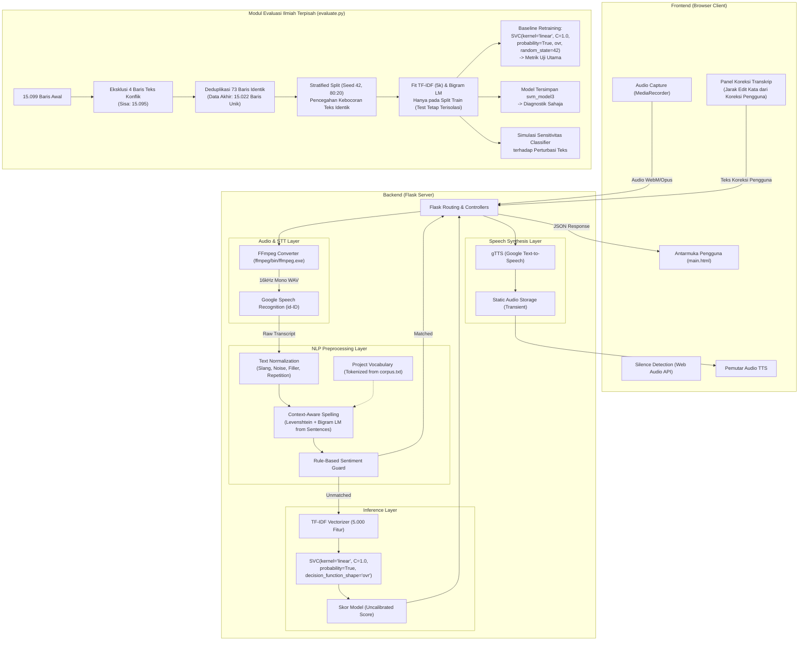

# Arsitektur Sistem — Voice Sentiment Analysis & STT Error Evaluation

Dokumen arsitektur tunggal resmi untuk prototipe tugas akhir:  
*“Analisis sentimen dari ucapan Bahasa Indonesia serta evaluasi pengaruh kesalahan Speech-to-Text terhadap hasil klasifikasi.”*

---

## 1. Diagram Arsitektur Sistem

---

## 2. Rincian Lapisan Sistem

### Lapisan 1: Antarmuka & Perekaman Klien (Presentation Layer)
- **Komponen**: `templates/main.html`, `static/css/style.css`, `static/js/record.js`.
- **Tanggung Jawab**:
  - Perekaman audio via `MediaRecorder` format `audio/webm;codecs=opus`.
  - Deteksi hening (*Voice Activity Detection / VAD*) via `AudioContext` untuk menghentikan rekaman secara otomatis tanpa batas waktu kaku.
  - State machine yang jelas: `IDLE`, `RECORDING`, `PROCESSING`, `COMPLETED`, `ERROR`.
  - Menyediakan panel perbandingan teks STT vs panel penyuntingan koreksi pengguna dengan metrik **Jarak Edit Kata dari Koreksi Pengguna** dan indikator **Skor Model**.

### Lapisan 2: Konversi Audio & Pengenalan Ucapan (Audio & STT Layer)
- **Komponen**: Executable lokal `ffmpeg/bin/ffmpeg.exe`, `speech_recognition`.
- **Tanggung Jawab**:
  - Konversi format WebM ke PCM WAV 16.000 Hz, 16-bit mono menggunakan binary lokal yang dibundel.
  - Mengirim stream WAV ke Google Speech Recognition Bahasa Indonesia (`id-ID`).
  - Menghapus berkas sementara (WebM & WAV) segera setelah transkripsi selesai.

### Lapisan 3: Pra-pemrosesan Teks (NLP Preprocessing Layer)
- **Komponen**: `preprocessing/normalization.py`, `preprocessing/context_spelling.py`, `preprocessing/ngram_model.py`.
- **Tanggung Jawab**:
  - Pembersihan derau (*noise*), tanda baca dengan proteksi angka, normalisasi slang, dan penghapusan kata jeda vokal lisan (*filler words*).
  - Pemanfaatan `model/corpus.txt` sebagai leksikon kata tunggal (bukan multi-kata dan bukan sebagai korpus bigram).
  - Pembangunan model Bigram LM berbasis kalimat riil yang telah dinormalisasi dari dataset, bukan dari daftar kata kamus.
  - Perbaikan scoring probabilitas log pada algoritma koreksi ejaan peka konteks.

### Lapisan 4: Klasifikasi Sentimen (Inference Layer)
- **Komponen**: `model/model3/svm_model3.pkl`, `model/model3/tfidf_vectorizer3.pkl`, `model/model3/label_encoder.pkl`, `model/rulebased.py`.
- **Tanggung Jawab**:
  - Vektorisasi TF-IDF 5.000 fitur unigram.
  - Klasifikasi menggunakan model `sklearn.svm.SVC` dengan parameter `kernel="linear"`, `C=1.0`, `probability=True`, `decision_function_shape="ovr"`.
  - Penyajian luaran sebagai **Skor Model** tanpa klaim probabilitas terkalibrasi.

### Lapisan 5: Sintesis Suara (TTS Layer)
- **Komponen**: `gtts`, direktori `static/tts/`.
- **Tanggung Jawab**:
  - Menghasilkan respon suara Bahasa Indonesia atas hasil prediksi secara verbal.
  - File suara bersifat sementara dan dibersihkan dari server.

### Lapisan 6: Evaluasi Ilmiah Terpisah (Offline Benchmark Layer)
- **Komponen**: Skrip independen `evaluate.py`.
- **Tanggung Jawab**:
  - Audit & deduplikasi dataset bertahap: 15.099 awal $\rightarrow$ 4 baris konflik dikeluarkan $\rightarrow$ 73 duplikat disingkirkan $\rightarrow$ 15.022 data unik akhir.
  - Mencegah kebocoran data spesifik teks identik antar-split (stratified split 80:20, seed 42 pada 15.022 teks unik).
  - Menjaga isolasi penuh test set: TF-IDF dan Bigram LM difit hanya pada data train.
  - Baseline retraining menggunakan konfigurasi classifier identik yang dapat direproduksi: `SVC(kernel="linear", C=1.0, probability=True, decision_function_shape="ovr", random_state=42)`.
  - Menyajikan evaluasi model tersimpan (`svm_model3.pkl`) sebagai **diagnostik**.
  - Mengukur ketahanan model melalui **Simulasi Sensitivitas Classifier terhadap Perturbasi Teks**.
